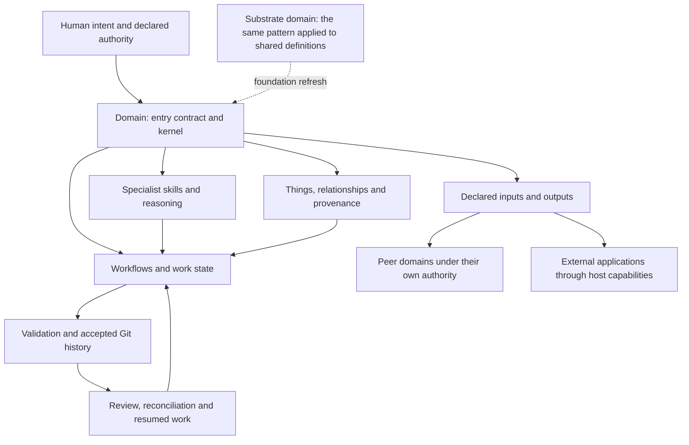

# Holistic substrate review — corrected framing and a discovery-route proposal

**Position.** The core architecture is substantially coherent. The substrate
already defines a domain that combines specialist knowledge, procedures,
durable work state, authority, exchange and revision, and applies that same
pattern to itself. No additional foundational primitive was identified as
necessary for the concrete workflows examined. The remaining findings concern
enforcement, execution bindings, deployment, recovery and visibility of the
existing compositions. This is a bounded conclusion, not proof that every
future application is covered.

**Review status.** This is a model-authored, operator-guided review, captured at
the operator's request. It is not a cold or independently framed review.
`stable` describes the filed snapshot, not certainty or human verification of
its conclusions. The operator's request to capture it does not approve its
findings or authorise implementation. Proposed remedies and the discovery
workflow remain proposals.

**Source boundary.** Public substrate evidence was read at
`commit:796aa2346c57c8f774c7d14f98a7b1e673c94412` (v3.50.0), with HEAD reasserted before capture. Selected
engineering, overview and regulatory domain records were also read at pinned
revisions. Following the existing review-record disclosure convention, this
release-surface copy omits private domain identities, repository locations,
private commit hashes, operational subject matter and external page IDs.
Private observations below are attributed as such and are not independently
reproducible from this repository alone. No private domain content is imported
as a normative substrate rule. Exposure: no; this is a substrate review record
for same-domain deliberation and later comparison.

## How the framing changed

The initial request asked for comparison with current agent memory systems.
That supplied a category before the system had been identified as a whole.
The agent consequently underweighted workflow execution and the network of
expert domains. The operator then supplied examples of repeatable workflows,
peer-domain exchange, several agents and machines, human acceptance gates,
and an external intake-to-assessment-to-publication route. A further challenge
pointed to tiered loading, the kernel and the domain pattern repeating at
different radii. The subsequent repository read found these concepts already
defined and, in several cases, implemented and exercised.

The operator's final correction is material: the initial prompt may explain
the misclassification. This session **does not isolate a discoverability
defect** in the substrate or documentation from prompt anchoring, model priors,
retrieval choices or the agent's own mistakes. The agent's statement that
needing author guidance was itself an established discoverability problem was
too strong and is withdrawn. Difficulty obtaining an independent whole-system
assessment is the reported problem; its causes remain to be tested.

The operator reports value from actual use and worries that repeatedly guiding
a model through the system introduces their own bias. That report is evidence
of experience, not a controlled comparison. The records examined provide
additional evidence of particular executions, but do not turn this dialogue
into a cold review after the fact.

The resulting assessment is useful as a corrected, evidence-backed baseline.
It must not be used as an independent confirmation of the operator's vision,
or silently combined with earlier category-anchored judgements as though all
were independent votes.

## The model recovered from the evidence

A domain contains an entry contract and operative floor; specialist skills and
lenses; things, relationships and provenance; workflows and work state;
mechanical validation and accepted history; inputs and outputs; and the
processes that revisit knowledge and methods when evidence changes.

The substrate domain applies this arrangement to its own definitions and
tools. A specialist domain applies it to its own subject matter. Larger
compositions reuse those capabilities while preserving ownership. Directory
nesting does not grant authority over another domain, and common structure
does not make every boundary equivalent.

The diagram shows composition, not a mandatory execution order or a claim that
every connection runs automatically. The more detailed specification graph
remains in [the framework map](../docs/framework-map.md).

**Loading has independent axes.** Specification tiers retain the mandatory
entry contract and kernel, then load fuller specifications or extensions when
needed. Thing depth moves from metadata to relationships to narrative for a
scoped subset. Domain skill selection follows the task. These rules are
already propagated by the domain-entry generator. Cross-domain work adds the
relevant exchange and provenance semantics; it does not entail loading the
whole producing domain. A startup-cost measurement of the substrate authoring
root must not be generalised to every business-domain workflow.

**Four routes need distinct treatment.** Foundation refresh carries shared
definitions from the substrate. Peer-domain exchange carries admitted evidence
through exposed faces and consumer-owned imports. Same-domain agent handoff
uses workflow roles, publication and watches. External application I/O uses
connectors and scoped authority. Describing them all as A2A obscures differences
in ownership, trust, transport and completion.

**The host remains part of the execution system.** An agent interprets the
domain's instructions through a harness that supplies tools, credentials,
permissions and lifecycle events. Portable definitions do not establish that
every host offers equivalent execution or enforcement. The existing adapter
architecture is the place to bind those capabilities.

## What already works and should be retained

- Workflow execution is a primary use of the substrate. Memory supports it;
  the memory-system comparison alone is an incomplete product assessment.
- The operating model already defines fractal composition, accumulative arcs,
  repeatable loops and consumer-owned contracts using existing primitives.
- Selective loading exists as doctrine and generated instructions. The
  inspected regulatory procedure also uses metadata-first candidate triage.
- The engineering domain already separates product purpose, operating surface
  and implementation location while sharing engineering methods. The earlier
  suggestion to invent that separation was unnecessary.
- The overview domain owns synthesis and proposals while leaving another
  domain's execution and decisions with that domain. Regulatory owns its
  readings and assessments while consumers own their decisions.
- Executor and authority are distinct. A different agent or automation can
  perform a stage without acquiring the right to pass a reserved human gate.
- Accepted records, declared inputs and revision history allow later review
  and reassessment. This supports inspection; it is not a complete trace of
  hidden model reasoning or proof of external truth.

Private operational evidence includes a 2026-10-04 dispatch record of a
completed regulatory assessment, its committed in-review record, publication
of a result page to Notion, and the intake row updated with the result link.
That run explicitly recorded no human verification or ruling. The return
procedure exists, but that particular run does not prove the return stages
were exercised. The same record also distinguishes successful Notion
publication from unresolved publication of the underlying repository state.

A later 2026-10-19 record reports unavailable connector access in unattended
execution. That failure does not erase the successful earlier run. Live Notion
inspection in this audit required reauthentication, so current remote state
was not independently confirmed.

## Remaining findings

**F1 — Reconciliation completion is not established by cue presence.**
The README promises that a definition change is refused until its dependants
are walked. The staged cue implementation accepts a covering cue without
checking a completed verdict, and an existing test explicitly opens the gate
with an open, unanswered cue. This is a concrete mismatch between that promise
and this mechanism. The evidence is the implementation and test contract, not
a newly demonstrated bypass of every harness configuration. A remedy should
make the intended completion condition explicit and enforce it where claimed,
while preserving the declared unattended route that raises and files a cue.
Neither a recorded verdict nor a gate can certify semantic correctness by
itself. Sources: [README](../README.md),
[staged report](../tools/markdownllm/touchpoints.py),
`test_staged_raise_writes_the_cue_pinned_to_head_and_opens_the_gate` in
[test_cues.py](../tools/tests/test_cues.py).

**F2 — Portable procedures have deployment-specific execution bindings.**
The inspected Notion ritual names one vendor's connector and discovery route;
a later unattended run records that connector as unavailable. This is an
observed deployment failure and a concrete portability limitation of that
ritual. The missing work concerns capability discovery, authentication,
permissions, launch and failure reporting on each supported host. Existing
adapters and the interface contract provide the architectural home. This does
not establish that every connector or host is defective. Private evidence:
regulatory intake procedure and 2026-10-19 dispatch record. Public basis:
[interface](../interface.md), [orchestration](../orchestration.md),
[dispatcher wrapper](../tools/dispatch/tick.ps1).

**F3 — Freshness checking exists, but inspected routes were not checkable.**
The audit's `estate-check` invocation could check none of the enumerated imports
in the inspected engineering and overview clones; results included untrusted
sources and incomplete route information. This is a clone-local deployment and
coverage observation, not proof that imports were stale or that other machines
have the same configuration. The combined estate denominator also included
incomplete external-source records and must not be presented as a count of
peer-domain imports. Complete and maintain the existing routes and deliberate
trust grants; report unchecked coverage honestly. Do not solve this by granting
trust automatically. Basis: audit-time command output; the existing mechanism
and its distinctions are in [provenance](../provenance.md).

**F4 — Recovery between external page creation and receipt recording is unclear.**
The inspected procedure creates a result page and then saves its URL on the
intake row. Draft-resume rules exist, but no explicit rule was found for an
interruption after creation succeeds and before recording the URL. This is a
static recovery ambiguity, not an observed duplicate. A stable operation
identity, durable receipt and lookup/reconciliation before retry could use
existing records and identifiers. Transport retries must remain distinct from
a requested new assessment. Private evidence: intake publication steps 1.6–1.7.

**F5 — Definition, implementation, deployment and execution evidence are hard
to assess together.** The audit had to reconstruct these across specifications,
code, plans, prompts and dispatch records. A definition, an implemented tool,
a configured deployment, one successful run and repeated reliability are
different claims. A derived operational view could make their evidence and
unknowns visible without adding another parallel ledger. This is a reviewer's
visibility judgement; this session does not isolate its effect on an uncoached
reader. The existing [framework map](../docs/framework-map.md) already maps
definitions and machinery; it should be built upon, not disregarded.

**F6 — The workflow-discovery heuristic excludes same-day histories.**
The emergence code retains a carrier's moves only when they span more than one
day. That is an explicit filter, also reflected in the build plan, rather
than an accidental absence of workflow support. It can exclude useful short
repeatable workflows. Evaluate the noise-versus-coverage trade-off with real
short-workflow examples before changing it. Authored workflows and execution
are unaffected. Sources: [workflows.py](../tools/markdownllm/workflows.py),
[workflows-emerge-from-use](../things/plans/workflows-emerge-from-use.md).

F1 and F6 are inspectable in the public snapshot. F2–F4 rely in part on private
deployment evidence. F5 is an interpretive assessment. None has been repaired
by filing this review; proposed fixes have not been approved or tested here.

## Extrapolation from existing pieces

| Desired extension | Existing basis | Composition or evidence still needed |
|---|---|---|
| Repeatable local work | Skills, definitions, runs and stage transitions | Recover useful working sequences; make inputs, gates and completion evidence explicit |
| Expert domains working together | Exposed faces, imports, provenance and consumer contracts | Declare admission, response and follow-up cadence for each direction |
| Several agents taking turns | Roles, watches, publication and advisory claims | Exercise missed wakes, contention and interrupted handoffs on each deployment |
| External application interface | I/O contract, external-content treatment and standing authority decisions | Bind the connector and specify partial-completion recovery |
| Impact analysis across a wider organisation | Relationships, reverse provenance, backward passes and reconciliation | Record and check the actual reliance edges; an absent edge cannot be traversed |
| Another agent or machine | Entry discovery, shared kernel and harness adapters | Test the capabilities and lifecycle bindings that host supplies |

Recommended consolidation: one repeatable local workflow, one peer-domain
handoff and the external intake/publication/return loop. Make their ownership,
loaded context, admitted inputs, output evidence, cadence and interruption
behaviour visible. This is a recommendation for selecting work, not a new
mandatory layer or a claim that these routes have never run.

The perceived bloat may be reduced by letting tasks lead to the capabilities
they need, keeping invariant rules in the kernel and placing rationale and
exceptions behind the relevant workflow. Complexity should be judged by the
attention imposed on a task and the outcome it protects, not by file count
alone. The causal role of documentation size remains unmeasured here.

## Candidate: identification and discovery before classification

**Problem reported by the operator.** Asking for a second opinion can itself
choose the wrong category. Correcting that category through dialogue may then
prime the reviewer toward the author's preferred interpretation. The opening
memory-system comparison in this session is a concrete example of that
confound; it is not a clean test of autonomous discovery.

**Candidate, not an implemented workflow.** Use existing read skills and
workflow primitives to create an evidence-led identification and discovery
route. `framework-discovery.md` already handles locating the substrate and its
loading contract; operational orientation already handles current domain
state. This candidate concerns learning what the supplied system is and
evaluating it before selecting an external comparison class. It must not teach
"fractal substrate", "all primitives exist" or this review's verdict as the
required answer.

There is no assumption-free or wholly author-independent reading: the corpus
itself contains author framing, and models have priors. A useful target is
independence from interactive author coaching, explicit assumptions, and
conclusions that can be challenged by their evidence. Architectural
identification, comparison-class selection and evaluation should be distinct
steps rather than an initial label silently governing all three.

An illustrative starting brief, not an installed prompt:

> Inspect the supplied repository and authorised examples. Establish from
> contracts, implementation and recorded use what exists, what people or
> systems can do with it, and where its boundaries lie. Record descriptions
> claimed by its authors separately from behaviour supported by evidence.
> Form a provisional account before selecting comparison categories. Seek
> counterexamples and missing evidence. Report strengths, defects, limits and
> uncertainty; retain disagreement when the evidence supports it.

Proposed stages to test:

1. **Bound the review.** Pin each authorised corpus, state access limits and
   exclusions, record the initial brief and the reviewer's initial assumptions.
   Follow the mandatory entry contract; selective loading still applies.
2. **Identify from evidence.** Inventory operations, state, authority, inputs,
   outputs and execution dependencies. Sample connected implementation and
   execution records as well as specifications. Do not choose a market category
   first or load the entire corpus indiscriminately.
3. **Trace representative paths.** Follow a local operation, a boundary crossing
   and a failed or interrupted operation where evidence permits. For each,
   distinguish intended behaviour, implementation, configured capability,
   recorded execution and unknowns. Record how examples were selected.
4. **Commit the initial account.** Preserve the model of the system, evidence,
   assumptions, omissions and provisional comparison classes before exposing
   the reviewer to this review or interactive corrective explanation.
5. **Challenge the account.** Seek contradictory records and alternative
   explanations; test whether the account transfers to a held-out workflow or
   domain. A verbal paraphrase of the documentation is insufficient evidence of
   understanding. Missing access stays an explicit limit.
6. **Evaluate and compare.** Select relevant comparison classes from the
   discovered capabilities. Classify gaps as conceptual, implementation,
   binding/deployment, evidence, or presentation; allow genuinely missing
   primitives if found. Current external comparisons require fresh research.
7. **Reveal and reconcile.** Only after the initial record is fixed, compare
   with another review and optional author clarification. Record exactly which
   conclusions changed and whether new facts or changed framing caused that.

The sequence is a hypothesis to exercise, not a new invariant to install in
every session. It may warrant a workflow because it has ordered stages,
durable intermediate outputs and a comparison boundary; reusable reading and
reasoning methods can remain skills.

**Success must mean calibrated understanding, not agreement with the author.**
A trial should preserve the initial prompt, source versions, access and reading
budget, intervention history, evidence-backed findings and material omissions.
Use independently selected examples and counterexamples where feasible. Compare
an ordinary broad review with the candidate route under comparable access and
budget; do not attribute improvement to the route when one reviewer received
more context or coaching. The evaluator should check trace accuracy, justified
classifications, discovery of known defects and handling of unknowns, rather
than reward reproduction of this review's architecture vocabulary. One trial
would demonstrate a case, not general reliability.

## Still untrodden; not reasons to delay this capture

- How much important reliance remains outside the declared graph, and what
  catches an omitted edge before a source change silently misses a consumer?
- How do conflicting interpretations across peer domains reach an accountable
  resolution in live use, beyond the existence of local conflict machinery?
- Under realistic load, do repeated loops dispose of work and maintain useful
  state faster than they generate maintenance obligations? No broad sustained
  measurement was made in this review.
- How reliably do interruption, resume, contention and external publication
  recovery behave across different hosts? Existing contracts are not equivalent
  to an executed cross-host failure matrix.
- Can a fresh reviewer identify the system without an imposed category or
  interactive author correction? This session cannot answer that question.

These are scoped questions for subsequent work. They are not declarations
that corresponding mechanisms are absent, and they should not trigger another
unbounded review before this baseline is retained.

## Comparison and provenance notes

For a future cold review, use an agreed pre-capture snapshot or explicitly
exclude this review from the initial evidence pass. Reading it first makes the
exercise a response or replication review. If the operator instead guides a
second agent through a similar conversation, compare two guided reviews and
retain the prompts and interventions; do not label the comparison blind.

Relevant public sources at the pinned revision:

- [AGENTS.md](../AGENTS.md), [kernel](../kernel.md),
  [read model](../read.thing.md), and
  [domain-entry generator](../tools/markdownllm/domain_kernel.py): entry,
  selective loading and generated propagation.
- [Operating model](../operating-model.md), [workflow state](../workflow-state.md),
  [universal workflow](../universal-workflow.md): existing composition and
  process primitives. Explicit workflow-run transition checks must not be
  generalised to claim every carrier departure is mechanically blocked.
- [Interface](../interface.md), [provenance](../provenance.md),
  [domain refresh](../domain-refresh.md), [standing watch](../standing-watch.md),
  [coordination claims](../coordination-claim.md),
  [orchestration](../orchestration.md): boundaries and runtime responsibilities.
- [Framework map](../docs/framework-map.md),
  [estate mechanics](../docs/estate-mechanics.md): existing maps to extend.
- [Change reconciliation](../change-reconciliation.md),
  [touchpoints implementation](../tools/markdownllm/touchpoints.py),
  [cue tests](../tools/tests/test_cues.py): F1.
- [Workflow implementation](../tools/markdownllm/workflows.py),
  [emergence plan](../things/plans/workflows-emerge-from-use.md): F6.

Private source classes inspected: engineering specification and read skill;
overview specification and read skill; regulatory specification, read and
workflow skills; the scoped Notion-publication authority decision; intake
procedure; 2026-10-04 and 2026-10-19 dispatch records. The first-hand user account
and this audit's tool observations are distinct evidence classes from those
records. This capture is not a fresh exhaustive competitor survey, a complete
security audit, or a claim to have inspected every estate domain.

The useful result is a corrected account with inspectable limits. The open
discovery question is how reliably another reviewer can reach its own account
from evidence before either a comparison category or the author's corrective
journey supplies the answer.
